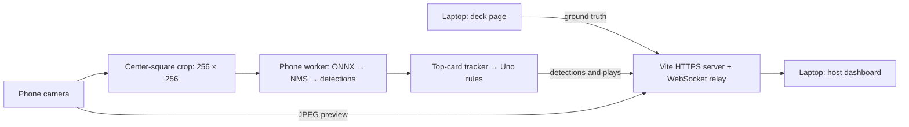
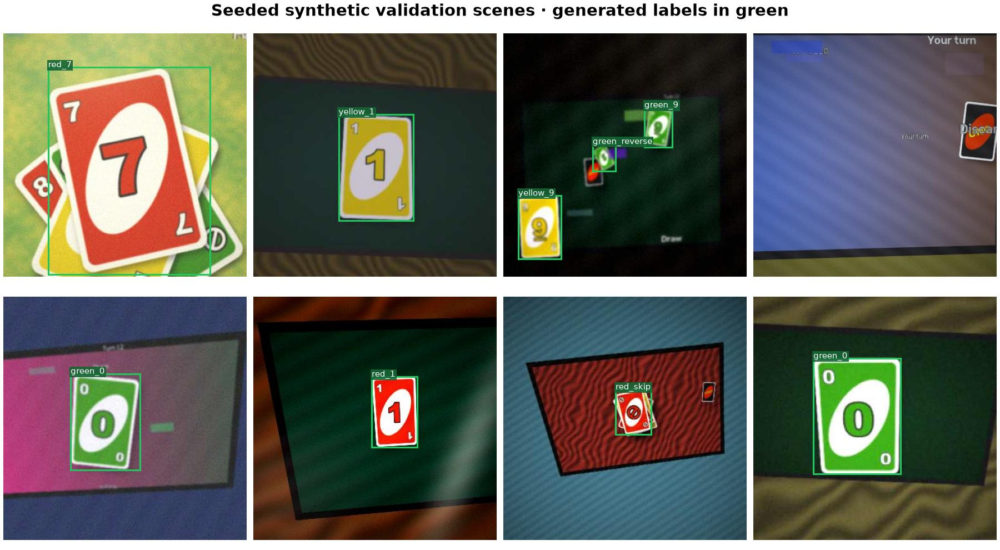
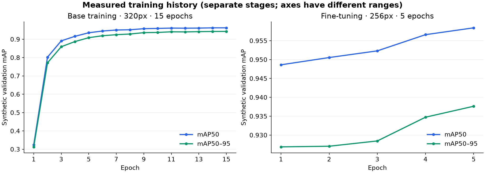
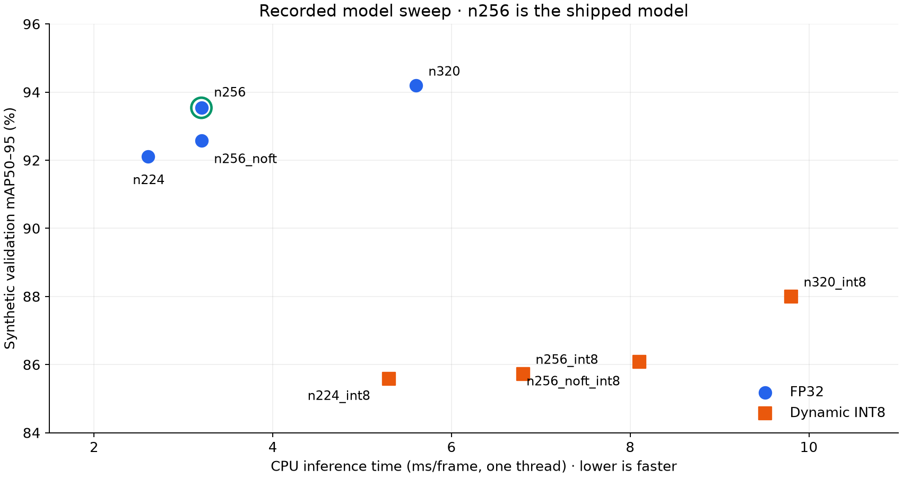

# uno-dos-tres

Point a phone camera at the Uno deck on your laptop. The phone recognizes cards with YOLO26n, tracks the top of the pile, and sends detections and game events to a live dashboard. **Inference runs on the phone** in a Web Worker using ONNX Runtime Web, with WebGPU and a single-threaded WASM fallback.

The trained **256px FP32 model and card SVGs are included**. Running the demo does not require Python, training, a GPU on the laptop, or a Cloudflare account. The laptop serves the app and relays messages; the phone can also send JPEG previews to the host.

## Quick start: local network

You need a laptop with **Node.js 24** (or Node ≥22.18), npm, and [mkcert](https://github.com/FiloSottile/mkcert#installation). Put the phone and laptop on the same network. Use a current phone browser that supports camera access, Web Workers and OffscreenCanvas; WASM is available when WebGPU cannot initialize.

On macOS, install mkcert once:

```sh
brew install mkcert
mkcert -install
```

On Windows or Linux, follow the linked mkcert installation instructions, then run `mkcert -install`. Install Node from [nodejs.org](https://nodejs.org/en/download), or run `nvm install` and `nvm use` if you already have nvm (the repo includes `.nvmrc`).

```sh
git clone https://github.com/Collaboration95/uno-dos-tres.git
cd uno-dos-tres
npm ci
npm run dev
```

`npm run dev` generates HTTPS certificates for localhost and your current LAN addresses, copies the ONNX Runtime files into `public/ort/`, and starts Vite plus the WebSocket relay on port 5173. Keep that terminal running.

1. On the laptop, open **Host** at `https://localhost:5173/` and **Deck** at `https://localhost:5173/deck.html` in separate windows.
2. Trust the laptop's mkcert certificate authority on the phone. On iOS, open `https://<laptop-lan-ip>:5173/ca` in Safari, install the downloaded profile under **Settings → General → VPN & Device Management**, then enable it under **Settings → General → About → Certificate Trust Settings**. On Android, install the downloaded CA using the device's certificate settings. Install only the public CA certificate; keep `.certs/key.pem` and mkcert's root private key on the laptop.
3. Scan the host's QR code, or open the **Phone (LAN)** URL printed in the terminal. Tap **START** and allow camera access.
4. Aim at the deck, keeping the top card inside the dashed center square. Flip a card and check that the host receives the preview, detections, and game events.

Camera access and the relay both need a trusted HTTPS connection. Accepting a browser's certificate warning alone may leave the iOS WebSocket connection blocked. Allow Node through your laptop firewall for LAN access; networks with client isolation may prevent devices from connecting.

## Optional: how the Cloudflare setup works

A [Cloudflare Quick Tunnel](https://developers.cloudflare.com/tunnel/get-started/quick-tunnels/) provides a temporary public HTTPS address, which lets a phone connect without installing the local CA. Install [cloudflared](https://developers.cloudflare.com/tunnel/downloads/) alongside mkcert; on macOS:

```sh
brew install cloudflared
npm run demo
```

The launcher checks the requested port, generates local certificates, copies the inference runtime, waits for the HTTPS server, then runs `cloudflared` against `https://localhost:5173`. Cloudflared skips certificate verification only for this local origin. The public phone connection uses Cloudflare's trusted HTTPS certificate.

It prints separate Phone, Host, and Deck links, and stores the generated address in **`.certs/tunnel-url`**, which is ignored by Git. The host reads that file to make its QR code. Open the printed Host and Deck links on the laptop, then scan the QR on the phone. Keep all devices on the same demo instance.

If port 5173 is busy, stop its existing server or use:

```sh
npm run demo -- --port 5174
```

The address changes each run and is accessible to anyone who has it. **Ctrl-C stops both child processes and removes the address file.** Quick Tunnels are for development and have no uptime guarantee. A connection or initialization problem is reported in the terminal; no live tunnel address is committed to this repository.

## Controls and phone options

| Deck control | Action |
| --- | --- |
| Space, →, or click outside the controls | Flip to the next card |
| ← | Undo |
| A | Toggle autoplay |
| [ / ] | Speed autoplay up / down |
| L | Toggle legal plays only |
| M | Cycle deck display modes |
| S | Reshuffle |
| H | Hide / show controls |

Phone query parameters can be combined, for example `/cam.html?ep=wasm&fps=8`:

| Parameter | Purpose |
| --- | --- |
| `ep=wasm` | Force the CPU/WASM backend if WebGPU has trouble |
| `ep=webgpu` | Force WebGPU; automatic fallback is disabled |
| `fps=8` | Set the active inference cap; default is 12 fps, with 4 fps when the scene is idle |
| `model=<name>` | Load `public/models/<name>.onnx` and its matching JSON metadata |

## What runs where



The tracker uses confidence, visible box size, and agreement across frames to avoid committing a play on a single-frame flicker. The dashboard compares phone detections and committed plays with the deck's ground truth. Its live measurements include camera, processing, and relay behavior; they are different from the offline model benchmarks below.

## Training method

Training targets the **phone-looking-at-a-screen** demo. It uses generated examples from the same card art as the deck, with 54 classes: 13 values in each of four colors, plus wild and wild draw-four. Card backs appear as unlabelled distractors.

```mermaid
flowchart LR
    Art["Shared class list + card SVG/PNG art"] --> Scenes["Synthetic screen scenes: cards, piles, UI, backgrounds"]
    Scenes --> Camera["Perspective, glare, moiré, blur, noise, JPEG"]
    Camera --> Data["15,000 train + 1,500 validation images at 384px"]
    Data --> Base["Pretrained YOLO26n: 15 epochs at 320px"]
    Base --> FineTune["Fine-tune: 5 epochs at 256px"]
    FineTune --> Export["FP32 ONNX + verified graph metadata"]
    Export --> Phone["Shipped model: phone inference"]
```



The generator samples single-card scenes (45%), piles (28%), scattered cards (22%), and scenes without face-up cards (5%). It applies perspective and camera effects and computes bounding boxes from the transformed geometry. Cards with less than 40% of their projected area visible are omitted from the labels. Training disables horizontal/vertical flips and hue shifts so digits and color-based classes keep their meaning.



The recorded base training took about 40 minutes and fine-tuning about 9 minutes on the original MPS setup. These are historical timings, not requirements for running the app.



## Why the shipped model uses 256px FP32



| Model | Input | Size (MB) | mAP50 | mAP50–95 | Top-card proxy | CPU ms/frame |
| --- | --- | --- | --- | --- | --- | --- |
| Base FP32 | 320px | 9.78 | 0.9610 | 0.9419 | 88.2% | 5.6 |
| Base FP32, smaller input | 256px | 9.76 | 0.9465 | 0.9258 | 89.3% | 3.2 |
| **Fine-tuned FP32 (shipped)** | **256px** | **9.76** | **0.9558** | **0.9354** | **90.7%** | **3.2** |
| Fine-tuned FP32 | 224px | 9.76 | 0.9429 | 0.9211 | 88.9% | 2.6 |
| Fine-tuned dynamic INT8 | 256px | 2.74 | 0.9528 | 0.8573 | 90.3% | 6.8 |

In this sweep, 256px fine-tuning retained most detection accuracy while reducing measured CPU inference time by about 43% versus 320px. Dynamic INT8 reduced download size but was slower on the measured CPU and lost localization accuracy, so the shipped model remains FP32.

These results use **synthetic validation data**. mAP50 and mAP50–95 measure detection performance at different overlap thresholds; the top-card proxy compares the largest labelled card with the highest-scoring prediction in up to 600 images. CPU latency is one-thread ONNX Runtime on the development machine, averaged over 60 runs after five warmups. It is **not measured phone latency or a guarantee for physical decks**. Training curves validate PyTorch checkpoints; the sweep validates exported ONNX graphs, so the scores differ slightly.

The current graph takes `[1, 3, 256, 256]` RGB float32 input and produces `[1, 58, 1344]`: four box coordinates plus 54 class scores per candidate. The worker applies non-maximum suppression. The metadata in [`public/models/uno.json`](public/models/uno.json) defines the input size and class order.

See [the complete sweep](ml/results.md), [committed figure sources and measurement details](docs/data/README.md), and [the training / export guide](ml/README.md). Training is optional; do not reorder `src/shared/classes.json` independently of the model.

## Verify and troubleshoot

```sh
npm run check
npm test
npm run build
```

`build` checks bundling and creates `dist/`. The WebSocket relay and `/api/info` are Vite **development-server plugins**; serving `dist/` alone does not provide the full demo. Use `npm run dev` or the optional `npm run demo` launcher for the three-device workflow.

| Symptom | What to check |
| --- | --- |
| Unsupported Node or syntax errors | Use Node 24 via `.nvmrc`, then run `npm ci` again. |
| `mkcert` / `cloudflared` missing | Install the binary and ensure its command works in the same terminal. Cloudflared is needed only for the optional tunnel. |
| Port 5173 unavailable | Stop the old server, use `npm run dev -- --port 5174`, or the demo port option above. |
| Phone cannot open the LAN link | Same network, firewall, LAN IP, and a trusted CA. Restart the dev server after changing networks to regenerate certificates. |
| Camera denied | Use HTTPS, grant browser camera permission, and tap START again. Avoid embedded in-app browsers. |
| Relay down on iOS | Install and explicitly trust the mkcert CA; dismissing the page warning is insufficient. |
| Model fails / video only | Try `?ep=wasm`; check `/models/uno.onnx`, `/models/uno.json`, and the `/ort/` requests. The startup commands copy runtime files automatically. |
| Wrong or expired QR link in LAN mode | Stop any old demo launcher; if it was forcibly killed, delete only `.certs/tunnel-url` and reload the host. |
| No tunnel URL / public link fails | Read the cloudflared logs, check internet access and local server readiness, and allow a few seconds for registration. |

Certificates, live tunnel addresses, ONNX Runtime copies, Python environments, generated datasets, and training checkpoints stay local via `.gitignore`. The portable ONNX model, card SVGs, dependency lockfiles, and figure measurements are committed.
